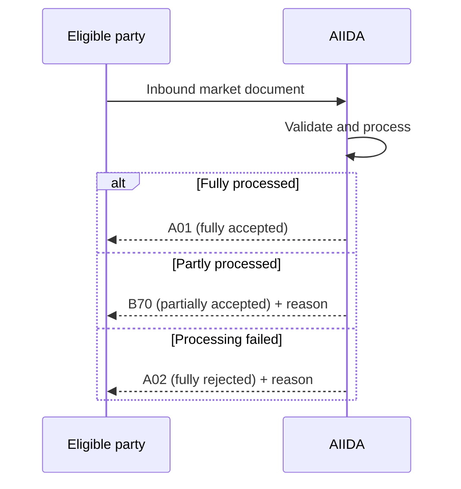

# Acknowledgements

AIIDA sends an acknowledgement for an inbound message when the data need has
`acknowledgementRequired` set to `true`. The acknowledgement describes the final processing result. It is not only a
transport receipt.



## Processing results

| AIIDA result         | CIM reason code | Meaning                                                                                                                      |
|----------------------|-----------------|------------------------------------------------------------------------------------------------------------------------------|
| `ACCEPTED`           | `A01`           | AIIDA processed every applicable part of the message successfully.                                                           |
| `PARTIALLY_ACCEPTED` | `B70`           | AIIDA processed part of the message and ignored or rejected another part. The reason text summarizes what was not processed. |
| `REJECTED`           | `A02`           | AIIDA could not apply any part of the message. The reason text explains the failure.                                         |

For connection limits, `B70` is used when AIIDA stores at least one point but ignores other points because newer or equally
recent values already exist. If all points are ignored or validation fails, AIIDA returns `A02`.

Examples of rejection reasons include:

- the document permission ID does not match the receiving permission
- the document meter ID does not match the permission meter ID
- the revision is not newer than the latest processed revision for the same mRID
- the mRID, creation time, or a valid revision is missing
- the document has no connection-limit points
- AIIDA encountered an error while processing the document

## Correlating an acknowledgement

The acknowledgement is a new market document and therefore has its own `MarketDocument.mRID`. Use the following fields to
trace it back to the inbound market document and permission:

| Acknowledgement field                                       | Use                                                                           |
|-------------------------------------------------------------|-------------------------------------------------------------------------------|
| `received_MarketDocument.mRID`                              | Primary correlation key. It contains the mRID of the inbound market document. |
| `received_MarketDocument.revisionNumber`                    | Identifies the inbound document revision.                                     |
| `received_MarketDocument.createdDateTime`                   | Identifies when the inbound document was created.                             |
| `received_MarketDocument.process.processType`               | Preserves the inbound process type.                                           |
| `MessageDocumentHeader.MetaInformation.requestPermissionId` | Identifies the receiving AIIDA permission.                                    |
| `MessageDocumentHeader.MetaInformation.dataNeedId`          | Identifies the data need.                                                     |
| `MessageDocumentHeader.MetaInformation.dataSourceId`        | Identifies the AIIDA inbound data source.                                     |
| `MessageDocumentHeader.MetaInformation.Asset`               | Identifies the configured asset, meter, and operator where available.         |

When an inbound payload is too malformed to read its market-document fields, AIIDA still returns an `A02` acknowledgement
with the permission and data-source metadata. Fields that cannot be recovered from that payload are omitted.

## Reading a failure

The first `Reason` contains both the resulting acknowledgement code and, for partial or failed processing, diagnostic text:

```xml

<received_MarketDocument.mRID>document-1</received_MarketDocument.mRID>
<received_MarketDocument.revisionNumber>2</received_MarketDocument.revisionNumber>
<Reason>
<code>A02</code>
<text>Revision 2 is not newer than the latest processed revision 2 for mRID document-1</text>
</Reason>
```

Consumers should correlate on `received_MarketDocument.mRID`, branch on the reason code, and expose the reason text when the
code is `B70` or `A02`. The complete CIM acknowledgement structure is documented in the
[EDDIE framework documentation](https://architecture.eddie.energy/framework/2-integrating/messages/cim/acknowledgement-market-documents.html).

## Current schema behavior

For `MIN_MAX_ENVELOPE_CIM_V1_12`, AIIDA waits for connection-limit validation and persistence before publishing the
acknowledgement. For `OPAQUE`, AIIDA has no schema-specific processor, so successful handoff to AIIDA's inbound stream is
reported as `A01`.
