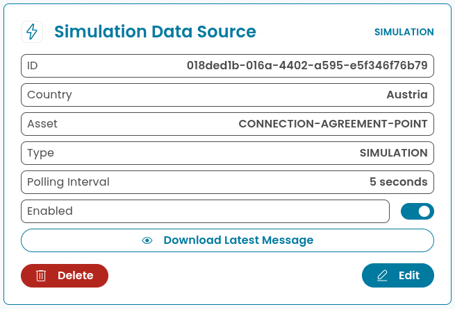

# Data Source: Simulation

> [Data Sources](../../data-sources.md) / [Interval-based](../interval-data-sources.md)

This data source was developed to simulate measurement data for testing and development purposes within AIIDA.
It generates random values for predefined OBIS codes at specified intervals.
The generated active power for consumption (import) and production (export) can be bounded by a minimum and maximum value.

| OBIS Code | Description                       |
|-----------|-----------------------------------|
| 1-0:1.8.0 | Total active energy import        |
| 1-0:2.8.0 | Total active energy export        |
| 1-0:1.7.0 | Instantaneous active power import |
| 1-0:2.7.0 | Instantaneous active power export |

## Integration with AIIDA

### Data Source Configuration

The simulation data source can be configured with a polling interval as well as energy consumption and production ranges.

| Field                | Description                                                                                                | Default |
|----------------------|------------------------------------------------------------------------------------------------------------|---------|
| `pollingInterval`    | Time in seconds between generated records. See [interval-based data sources](../interval-data-sources.md). | `5`     |
| `minConsumptionWatt` | Minimum instantaneous active power for consumption (import) in watt.                                       | `200`   |
| `maxConsumptionWatt` | Maximum instantaneous active power for consumption (import) in watt.                                       | `1800`  |
| `minProductionWatt`  | Minimum instantaneous active power for production (export) in watt.                                        | `0`     |
| `maxProductionWatt`  | Maximum instantaneous active power for production (export) in watt.                                        | `1200`  |

Both bounds are inclusive; every field is required.
Each maximum must be greater than or equal to its minimum.
Setting both bounds of a direction to the same value always produces exactly that value.
Setting the consumption or production bounds both to `0` effectively disables that direction.
AIIDA rejects data sources whose maximum is smaller than its minimum with `400 Bad Request`.

### Setup in AIIDA

The same inputs have to be entered as described in the [general data source documentation](../../data-sources.md) and in
the [interval-based data source documentation](../interval-data-sources.md).

### Connect with AIIDA

The simulation data source is part of AIIDA itself.
Once the data source is created in the AIIDA user interface, it will start generating data at the specified polling interval.

## Additional things to consider

The generated data is random and does not represent real-world measurements.
