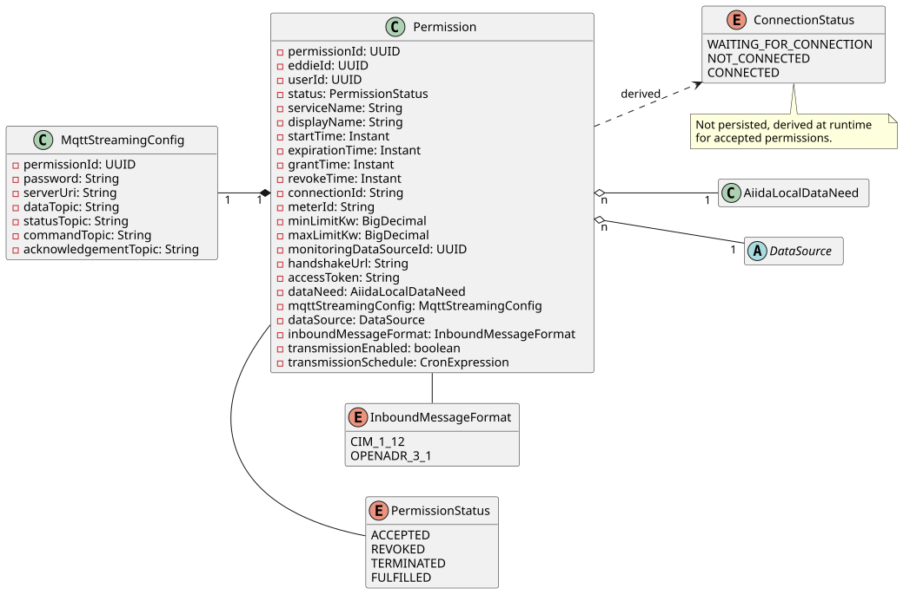
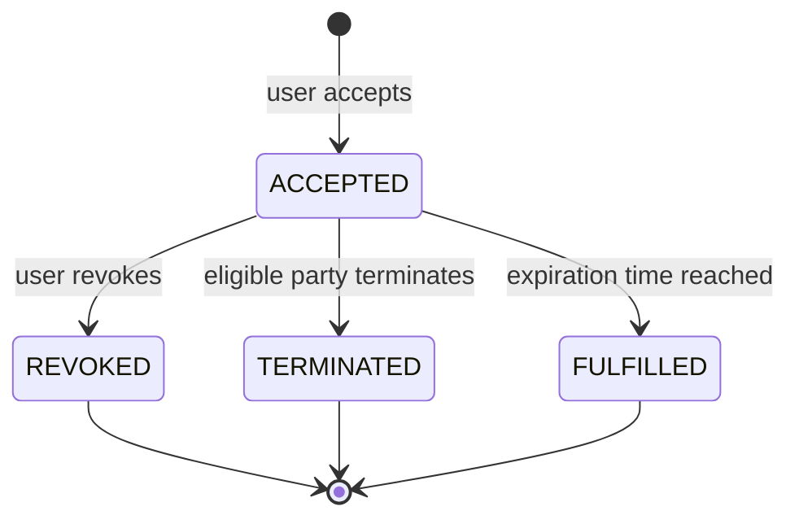
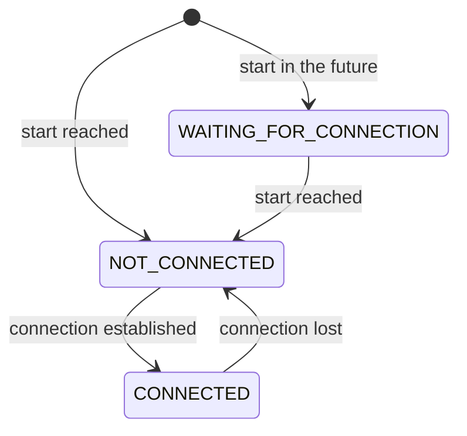
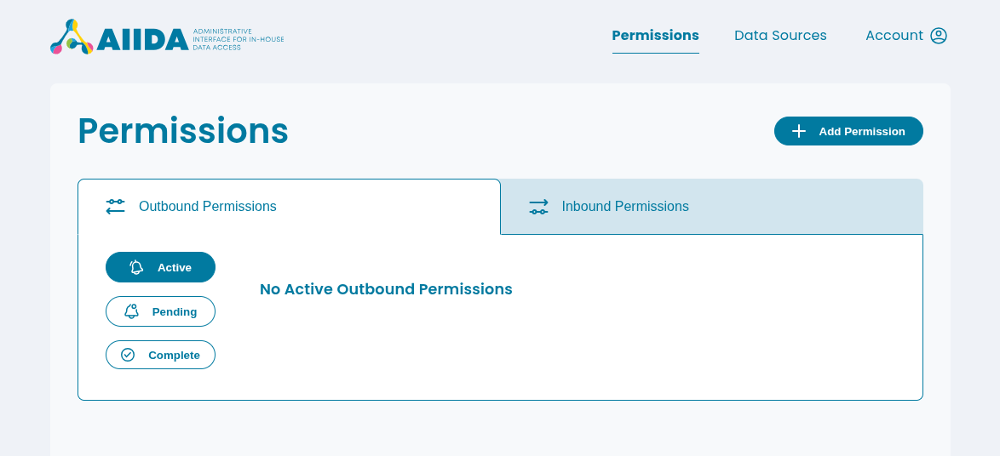
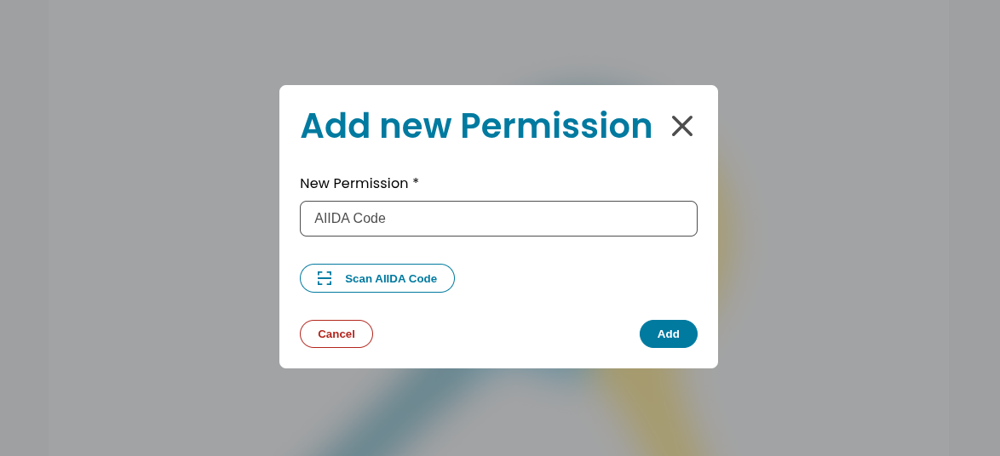
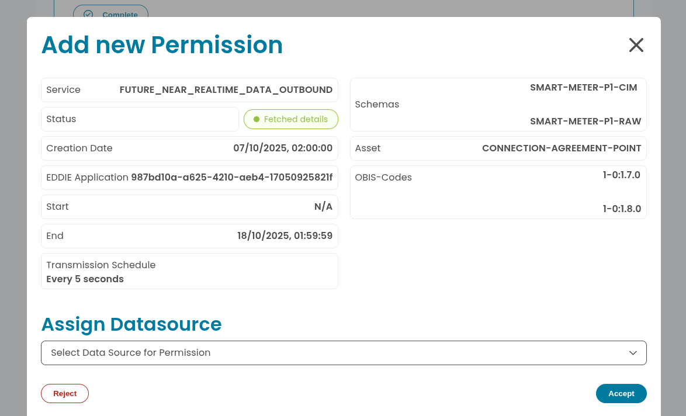

# Permissions

AIIDA uses permissions to control the sharing of near-real time data.
One permission in AIIDA correlates to one permission of an EDDIE instance.

## Stored Data

The following class diagram shows the main entities involved in the permission system.

Each permission is associated with a single `Datasource` and a single `DataNeed` (`LocalAiidaDataNeed`).
Permissions are only stored once the user accepted them.
Permission requests that are rejected or cannot be fulfilled are never stored in AIIDA.

AIIDA is communicating with EDDIE over MQTT. After the handshake between AIIDA and EDDIE, AIIDA receives the
`MqttStreamingConfig` from EDDIE.
This configuration contains the necessary information to connect to the MQTT broker of EDDIE.
It also specifies the topics on which AIIDA can publish and subscribe to.

## Permission and connection states

The state of a permission is described by two independent values.

The `PermissionStatus` describes the lifecycle of a permission and is stored in the database.
Every permission starts as `ACCEPTED` and ends in exactly one of the final states.

| Status       | Description                                                       |
|--------------|-------------------------------------------------------------------|
| `ACCEPTED`   | The user accepted the permission request.                         |
| `REVOKED`    | The user revoked the permission.                                  |
| `TERMINATED` | The eligible party terminated the permission.                     |
| `FULFILLED`  | The expiration time of the permission was reached.                |

The `ConnectionStatus` describes whether an accepted permission is currently connected to the MQTT broker of EDDIE.
It is not stored, but derived at runtime, and is only available for `ACCEPTED` permissions.
It may change as often as necessary, e.g. when the connection is lost and re-established.

| Connection status        | Description                                                                         |
|--------------------------|-------------------------------------------------------------------------------------|
| `WAITING_FOR_CONNECTION` | The start of the permission lies in the future, so AIIDA does not connect yet.      |
| `NOT_CONNECTED`          | AIIDA is not connected, e.g. because the connection failed on start-up or was lost. |
| `CONNECTED`              | AIIDA is connected and shares data.                                                 |

The AIIDA Web UI is notified about changes of the connection status and updates them without reloading the page.

## Adding a permission

Adding a permission is done via the AIIDA Web UI.
After logging in, navigate to the "Permissions" section and click on "Add Permission".

A dialog will appear in which the AIIDA code of the permission can be entered.
The AIIDA code can be obtained from the EDDIE permission facade.

After entering a valid AIIDA code, AIIDA fetches the details of the permission request from EDDIE and checks whether it can
fulfill it, e.g. that the start date does not lie in the past and that the data need is supported.
If the permission request cannot be fulfilled, AIIDA informs EDDIE with the reason and shows an error.
Nothing is stored at this point, so the AIIDA code can be used again as long as the permission request was neither
accepted nor rejected.

Otherwise, another dialog will appear showing the details of the permission request, for example:

- Service name
- EDDIE ID
- Start and end date (in UTC)
- Transmission schedule
- The applied schema transformation on the shared data
- The asset type
- The required OBIS codes

For outbound permissions, the user must select a data source which will be associated with this permission.
The data source represents the source of the data that will be shared under this permission and must match the asset
type of the data need.
For inbound permissions, AIIDA creates the data source automatically once the permission is accepted.

The user must now either accept or reject the permission using the respective buttons.

- **Accept**: AIIDA fetches and checks the details again, accepts the permission request at EDDIE, receives the
  `MqttStreamingConfig` and stores the permission as `ACCEPTED`.
  Depending on the start date, data sharing starts immediately or is scheduled to start at a later date.
- **Reject**: AIIDA informs EDDIE that the user rejected the permission request. Nothing is stored in AIIDA.

When AIIDA restarts, it resumes data sharing for all accepted permissions and marks permissions whose expiration time
was reached in the meantime as `FULFILLED`.
